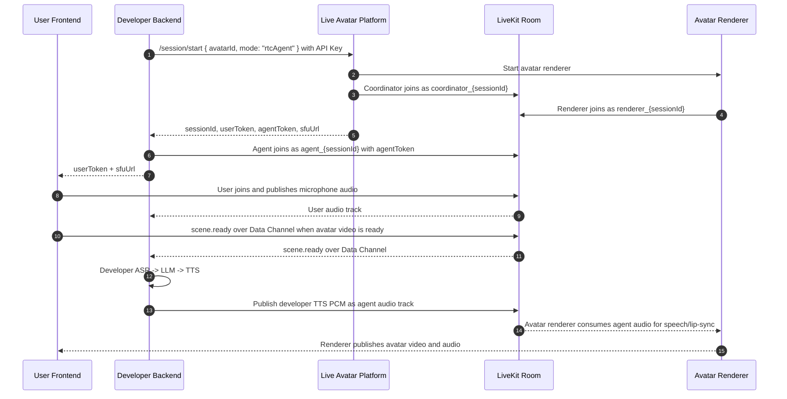

# Live Avatar Platform RTC Protocol

**English** | [中文](./PROTOCOL.zh.md)

This document describes the backend-facing protocol used by
`liveavatar-platform-rtc` in `mode: "rtcAgent"`.

Platform RTC is different from WebSocket Agent mode: the developer backend owns
ASR, LLM, and TTS. The platform accepts avatar output as a LiveKit audio track;
the SDK therefore does not provide platform text-TTS helpers such as
`response.chunk` or `response.done`.

## Session model



Only the backend receives the API Key and agent token. The frontend receives
only `userToken` and `sfuUrl`.

## Scope

This protocol version supports one backend RTC agent, one frontend user, and one
avatar renderer in a session.

It does not include:

- BYO RTC rooms or external SFU ownership;
- multiple users or multiple simultaneous user audio tracks;
- multiple avatars or multiple agents in the same room;
- platform TTS driven by `response.chunk` / `response.done`.

## Audio tracks

### User input audio

The SDK subscribes to the frontend user's LiveKit audio track and emits
`user_audio_frame` events with mono PCM16 frames resampled to
`input_sample_rate` (default `16000` Hz).

These frames are intended for developer-owned ASR or an Omni model.

### Avatar output audio

Developer TTS output is published with:

```python
await session.publish_audio(frame)
await session.publish_audio_stream(frames)
```

Each `AudioFrame` must contain mono PCM16 at the negotiated output sample rate.
The recommended default is `24000` Hz. The effective output rate may be
overridden by the session-start response according to the avatar configuration.
LiveKit handles realtime playout, resampling as needed, and Opus encoding.

Only one output stream may be active at a time. `session.interrupt()` cancels
the local stream, clears queued playout, sends `control.interrupt`, and emits
the local `interrupted` hook so applications can also cancel LLM/TTS providers.

## Readiness events

The backend should wait for these stages before publishing avatar speech:

1. `client.connect()` starts the platform session and connects the backend
   agent to LiveKit.
2. `session.wait_for_user()` waits for the frontend user to join.
3. `session.wait_for_scene_ready()` waits for `scene.ready`.

`scene.ready` means the avatar video scene is ready on the user side. It does
not mean ASR, LLM, or TTS providers are ready; those are developer-owned
resources and should be prepared by the backend separately.

## Data Channel events

RTC Agent control events are JSON envelopes sent over reliable LiveKit Data
Channel messages.

The SDK dispatches by the JSON `event` field and does not assign protocol
meaning to LiveKit Data Channel topics. Incoming packets are not filtered by
topic. `DataChannelEvent.topic` is retained only as diagnostic metadata when a
participant supplies one.

Common incoming events:

| Event | SDK event | Meaning |
| --- | --- | --- |
| `scene.ready` | `SCENE_READY` | Avatar video scene is ready on the frontend |
| `scene.resourceTransition` | `SCENE_RESOURCE_TRANSITION` | Renderer is about to switch video resources |
| `session.state` | `SESSION_STATE` | Platform session state update |
| `session.closing` | `SESSION_CLOSING` | Platform is about to close the session |
| `system.idleTrigger` | `IDLE_TRIGGER` | Platform-side idle notification |
| `error` | `ERROR` | Protocol or platform error |
| unknown valid envelope | `CUSTOM_EVENT` | Application or future protocol event |

### `scene.resourceTransition`

The platform sends this event when the renderer has finished the current video
and is about to switch to the next configured video resource. It is delivered as
a `DataChannelEvent` through `session.on(SCENE_RESOURCE_TRANSITION)`.

```json
{
  "event": "scene.resourceTransition",
  "requestId": "renderer_req_1",
  "timestamp": 1710000000000,
  "data": {
    "previousResourceId": "video_a",
    "nextResourceId": "video_b",
    "message": "switch from video_a to video_b"
  }
}
```

| Field | Location | Required | Meaning |
| --- | --- | --- | --- |
| `previousResourceId` | `data` | Yes | Stable business ID of the video resource being switched away from. It is not a URL, file path, or display name. |
| `nextResourceId` | `data` | Yes | Stable business ID of the video resource the renderer is about to switch to. It is not a URL, file path, or display name. |
| `message` | `data` | No | Optional human-readable context for logs or diagnostics. Do not branch business logic on it. |
| `requestId` | envelope | No | Platform-generated request/correlation ID for tracing this notification. |
| `timestamp` | envelope | No | Platform event time in epoch milliseconds when supplied. |

The event is a one-way notification. The backend does not reply to it, and a
handler cannot acknowledge, cancel, or delay the renderer switch. There is no
`streamId` field because the active RTC session scopes the stream. If either
resource ID is missing or blank, or `message` is present but not a string, the
SDK dispatches `protocol_error` and does not dispatch the event handler.

Common outgoing helpers:

| Method | Event | Purpose |
| --- | --- | --- |
| `send_voice_start(request_id)` | `input.voice.start` | Developer VAD detected speech start |
| `send_asr_partial(request_id, text, seq)` | `input.asr.partial` | Developer ASR partial result |
| `send_voice_finish(request_id)` | `input.voice.finish` | Developer VAD detected speech end |
| `send_asr_final(request_id, text)` | `input.asr.final` | Developer ASR final result |
| `interrupt(request_id=None)` | `control.interrupt` | Cancel current avatar output |
| `send_custom_event(event, data, ...)` | custom | Application-owned event envelope |

There are intentionally no `response.chunk` / `response.done` helper methods in
the RTC SDK. Avatar speech is transported by the developer-published LiveKit
audio track.

## Error handling

Wait helpers raise:

- `SessionWaitTimeoutError` when a readiness stage times out;
- `SessionClosedError` when the session closes while waiting or publishing.

Audio publishing raises:

- `AudioFormatError` when the frame is not mono PCM16 at the negotiated output
  sample rate;
- `AudioPublishError` when LiveKit publication fails.

Unknown but valid envelopes are preserved as `CUSTOM_EVENT`. Malformed known
events dispatch protocol errors instead of being silently ignored.
