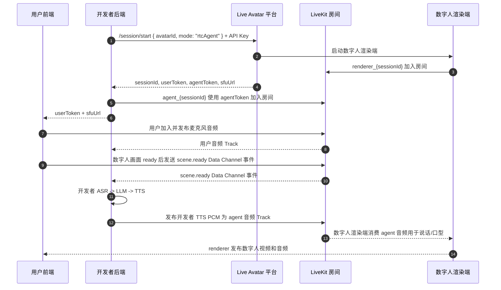

# Live Avatar Platform RTC 协议

**中文** | [English](./PROTOCOL.md)

本文档描述 `liveavatar-platform-rtc` 在 `mode: "rtcAgent"` 下使用的后端协议。

Platform RTC 不同于 WebSocket Agent 模式：ASR、LLM 和 TTS 都由开发者后端
负责。平台接收数字人输出的方式是 LiveKit 音频 Track；因此 SDK 不提供
`response.chunk` 或 `response.done` 这类平台文本 TTS helper。

## 会话模型



只有后端可以持有 API Key 和 agent token。前端只接收 `userToken` 和 `sfuUrl`。

## 适用范围

本协议版本支持一个后端 RTC Agent、一个前端用户、一个数字人渲染端。

不包含：

- BYO RTC 房间或外部 SFU 所有权；
- 多用户或多个同时存在的用户音频 Track；
- 同一房间内的多数字人或多 Agent；
- 由 `response.chunk` / `response.done` 驱动的平台 TTS。

## 音频 Track

### 用户输入音频

SDK 订阅前端用户的 LiveKit 音频 Track，并通过 `user_audio_frame` 事件输出
单声道 PCM16 帧，重采样到 `input_sample_rate`（默认 `16000` Hz）。

这些帧用于开发者自有 ASR 或 Omni 模型。

### 数字人输出音频

开发者 TTS 输出通过以下方法发布：

```python
await session.publish_audio(frame)
await session.publish_audio_stream(frames)
```

每个 `AudioFrame` 必须是单声道 PCM16，采样率必须等于协商后的输出采样率。
推荐默认值是 `24000` Hz。最终生效的输出采样率可能由会话启动响应根据数字人
配置覆盖。实时播放缓冲、必要的重采样和 Opus 编码由 LiveKit 负责。

同一时间只能有一个输出流。`session.interrupt()` 会取消本地输出流、清空待播放
队列、发送 `control.interrupt`，并触发本地 `interrupted` hook，方便应用同时
取消 LLM/TTS provider。

## 就绪事件

后端应在发布数字人语音前等待这些阶段：

1. `client.connect()` 启动平台会话，并让后端 Agent 加入 LiveKit。
2. `session.wait_for_user()` 等待前端用户加入房间。
3. `session.wait_for_scene_ready()` 等待 `scene.ready`。

`scene.ready` 表示用户侧数字人视频画面已经准备好。它不表示 ASR、LLM 或 TTS
provider 已经准备好；这些都是开发者自有资源，应由后端自行准备。

## Data Channel 事件

RTC Agent 控制事件是通过可靠 LiveKit Data Channel 发送的 JSON envelope。

SDK 根据 JSON 的 `event` 字段分发事件，不给 LiveKit Data Channel topic 赋予
协议语义。入站 packet 不会按 topic 过滤。`DataChannelEvent.topic` 仅作为诊断
元数据保留，用于观察某个 participant 是否携带了 topic。

常见入站事件：

| Event | SDK 事件 | 含义 |
| --- | --- | --- |
| `scene.ready` | `SCENE_READY` | 前端数字人视频画面已 ready |
| `scene.resourceTransition` | `SCENE_RESOURCE_TRANSITION` | renderer 即将切换视频资源 |
| `session.state` | `SESSION_STATE` | 平台会话状态更新 |
| `session.closing` | `SESSION_CLOSING` | 平台即将关闭会话 |
| `system.idleTrigger` | `IDLE_TRIGGER` | 平台侧 idle 通知 |
| `error` | `ERROR` | 协议或平台错误 |
| 未知但合法的 envelope | `CUSTOM_EVENT` | 应用自定义或未来协议事件 |

### `scene.resourceTransition`

平台会在 renderer 播放完当前视频、即将切换到下一个已配置视频资源时发送该事件。
SDK 会通过 `session.on(SCENE_RESOURCE_TRANSITION)` 将它作为 `DataChannelEvent`
分发给业务处理器。

```json
{
  "event": "scene.resourceTransition",
  "requestId": "renderer_req_1",
  "timestamp": 1710000000000,
  "data": {
    "previousResourceId": "video_a",
    "nextResourceId": "video_b",
    "message": "switch from video_a to video_b"
  }
}
```

| 字段 | 位置 | 是否必填 | 含义 |
| --- | --- | --- | --- |
| `previousResourceId` | `data` | 是 | 即将切走的上一个视频资源的稳定业务 ID。它不是 URL、文件路径或展示名称。 |
| `nextResourceId` | `data` | 是 | 即将切到的下一个视频资源的稳定业务 ID。它不是 URL、文件路径或展示名称。 |
| `message` | `data` | 否 | 可选的可读说明文本，仅适合日志或排查，不要用它做业务分支判断。 |
| `requestId` | envelope | 否 | 平台生成的请求/关联 ID，用于链路追踪该通知。 |
| `timestamp` | envelope | 否 | 平台事件时间，单位为 epoch milliseconds。 |

该事件是单向通知。后端无需回复，handler 也不能确认、取消或延迟 renderer 的视频
切换。事件没有 `streamId` 字段，因为当前 RTC session 已经限定了 stream 范围。
如果任一资源 ID 缺失或为空白字符串，或者 `message` 存在但不是字符串，SDK 会派发
`protocol_error`，不会触发业务事件处理器。

常见出站 helper：

| Method | Event | 用途 |
| --- | --- | --- |
| `send_voice_start(request_id)` | `input.voice.start` | 开发者 VAD 检测到语音开始 |
| `send_asr_partial(request_id, text, seq)` | `input.asr.partial` | 开发者 ASR 中间结果 |
| `send_voice_finish(request_id)` | `input.voice.finish` | 开发者 VAD 检测到语音结束 |
| `send_asr_final(request_id, text)` | `input.asr.final` | 开发者 ASR 最终结果 |
| `interrupt(request_id=None, interrupt_scope=None)` | `control.interrupt` | 不传、空字符串或 `VOICE_ONLY`：只停止人声。`BGM_ONLY`：只清还没播出的外部音频，本地人声继续推。`VOICE_AND_ACCOMPANIMENT`：停止人声并清还没播出的外部音频。底板视频自带声音不会被清掉。 |
| `publish_external_audio(pcm)` | `external.audio.chunk` | 发送伴奏 PCM。不要用 `publish_audio` |
| `send_external_playback(request_id, response_id, frames)` | `response.audio.start` / LiveKit 音频 / `response.audio.finish` | 把开发者 PCM 当人声轮播放。`data.purpose` 为 `external`。裸 PCM，不加 WebSocket 帧头 |
| `send_custom_event(event, data, ...)` | 自定义 | 应用自有事件 envelope。切视频发送 `scene.switchVideo` |

### `scene.switchVideo`

没有 typed `switch_video` 方法。发送：

```python
await session.send_custom_event(
    "scene.switchVideo",
    {
        "onceVideos": ["fist_bump"],
        "loopVideos": ["LOOP_ID"],
        "mode": "HARD",
    },
)
```

事件名在前，`request_id` 是关键字参数。字段名必须是 camelCase。`mode` 为 `HARD` 或
`GRACEFUL`（默认）。无法识别时按 `GRACEFUL`。每一项可以是
resourceId 或底板 alias。`onceVideos`、`loopVideos`、`videoChoreographyGroups`
至少一个非空。画面切换看 `scene.resourceTransition`。完整说明见
[README.zh.md](./README.zh.md#切视频)。

RTC SDK 有意不提供 `response.chunk` / `response.done` helper。数字人语音通过
开发者发布到 LiveKit 的音频 Track 传输。

## 错误处理

等待 helper 可能抛出：

- `SessionWaitTimeoutError`：等待阶段超时；
- `SessionClosedError`：等待或发布期间会话关闭。

音频发布可能抛出：

- `AudioFormatError`：音频不是协商输出采样率下的单声道 PCM16；
- `AudioPublishError`：LiveKit 发布失败。

未知但合法的 envelope 会保留为 `CUSTOM_EVENT`。格式错误的已知事件会派发协议
错误，而不是被静默忽略。
